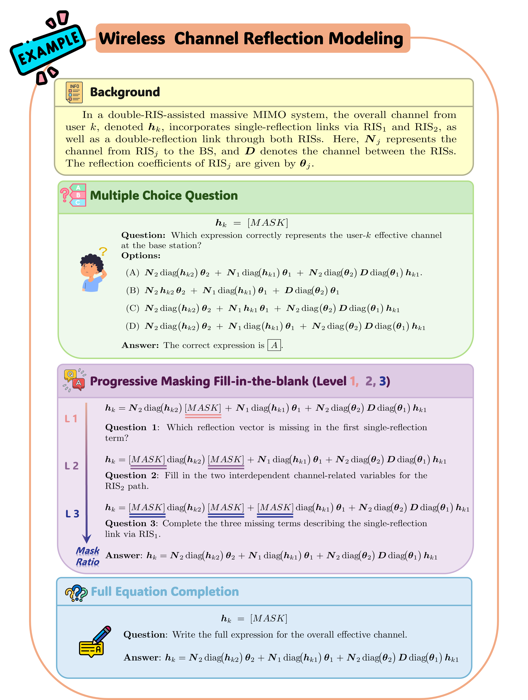

<div align="center">

# WirelessMathBench

### A Mathematical Modeling Benchmark for LLMs in Wireless Communications

*Findings of ACL 2025*

[Xin Li](https://lixin.ai)¹, [Mengbing Liu](https://www.liumengbing.com)¹, [Li Wei](https://scholar.google.com.sg/citations?user=zdSz9-gAAAAJ&hl=en)¹, Jiancheng An¹, [Mérouane Debbah](https://scholar.google.com/citations?user=HU5I0X4AAAAJ&hl=en)², [Chau Yuen](https://blogs.ntu.edu.sg/chau-yuen/)¹<br>
¹ School of EEE, Nanyang Technological University, Singapore ·
² Department of Computer and Information Engineering, Khalifa University, UAE

[](https://arxiv.org/abs/2505.14354)
[](https://aclanthology.org/2025.findings-acl.573/)
[](https://lixin.ai/WirelessMathBench/)
[](https://huggingface.co/datasets/XINLI1997/WirelessMathBench)
[](#license)

**A benchmark that evaluates LLMs on mathematical modeling challenges in wireless communications engineering.**

</div>

<p align="center">
  
</p>

## The idea in 30 seconds

- **The gap.** LLMs have achieved impressive results across a broad array of tasks, yet their capacity for complex,
  domain-specific mathematical reasoning, particularly in wireless communications, remains underexplored.
- **The benchmark.** 587 meticulously curated questions sourced from 40 state-of-the-art research papers, all of which
  rigorously adhere to physical and dimensional constraints.
- **Three task types.** Multiple-choice questions (MCQs); progressively masked fill-in-the-blank at three masking
  levels; and full equation completion (FEC), where the entire equation is hidden and must be derived from a
  description of the wireless scenario.
- **Result.** Many models excel in basic recall tasks, but their performance degrades significantly when reconstructing
  partially or fully obscured equations. Even DeepSeek-R1, the best performer, achieves an average accuracy of only
  38.05%, with a mere 7.83% success rate in full equation completion.

## Main results

Accuracy of leading LLMs by task type. Level 1–3 are the three masking levels of the fill-in-the-blank questions.

| Model | MCQ | Level 1 | Level 2 | Level 3 | FEC | Avg. Acc |
|---|:---:|:---:|:---:|:---:|:---:|:---:|
| DeepSeek-R1 | 76.00% | 60.00% | 34.91% | 12.50% | 7.83% | 38.05% |
| OpenAI-o1 | 66.40% | 59.17% | 32.17% | 8.04% | 6.96% | 34.55% |
| DeepSeek-V3 | 78.40% | 50.00% | 24.35% | 6.25% | 6.96% | 33.19% |
| GPT-4o | 72.80% | 42.50% | 28.70% | 6.25% | 4.35% | 30.92% |
| Gemini-1.5-pro | 65.60% | 43.33% | 29.57% | 9.82% | 6.09% | 30.88% |

**Error analysis.** In 40 randomly sampled errors from DeepSeek-R1: partial fill mismatch 31%, symbol
misinterpretation 29%, incorrect equation derivation 24%, irrelevant system mixing 11%.

## Quick start

Load the benchmark from Hugging Face:

```python
from datasets import load_dataset

dataset = load_dataset("XINLI1997/WirelessMathBench", data_files="WirelessMathBench.json")
print(len(dataset["train"]))
```

Expected: `587`.

## Data

[🤗 XINLI1997/WirelessMathBench](https://huggingface.co/datasets/XINLI1997/WirelessMathBench): the 587 questions in one
JSON file (`id`, `type`, `background`, `question_text`, `options`, `correct_answer`, `equation`, `domain`).

<details>
<summary>Topic coverage</summary>

- **Model-based topics:** RIS (19 papers), MIMO (12 papers), UAV (6 papers), ISAC (6 papers), Satellite (4 papers),
  SIM (3 papers), NOMA (2 papers).
- **Problem-based topics:** Beamforming (18 papers), Channel Estimation (12 papers), Performance Analysis (8 papers),
  Trajectory Design (5 papers), Power Allocation (5 papers), Resource Management (4 papers).

</details>

## Repository layout

This repository holds the [project page](https://lixin.ai/WirelessMathBench/). To view it locally, open `index.html`
in your web browser.

```
index.html, styles.css, script.js   project page
teaser.png, teaser.webp             teaser figure
wordcloud.png                       word cloud of the topics
error_distribution.png              error analysis chart
```

## Citation

```bibtex
@inproceedings{li2025wirelessmathbench,
  title={WirelessMathBench: A Mathematical Modeling Benchmark for LLMs in Wireless Communications},
  author={Li, Xin and Liu, Mengbing and Wei, Li and An, Jiancheng and Debbah, Mérouane and Yuen, Chau},
  booktitle={Findings of the Association for Computational Linguistics: ACL 2025},
  year={2025}
}
```

## License

The dataset on Hugging Face is licensed under CC BY 4.0. This website template is provided for use with the
WirelessMathBench project.

## Contact

For questions, contact [xin019@e.ntu.edu.sg](mailto:xin019@e.ntu.edu.sg).
